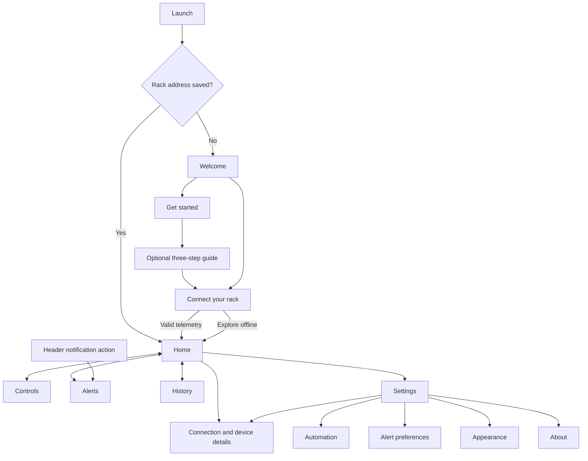

# Smart Drying Rack — complete design concept

These are proposed designs, not screenshots or a claim that every proposed capability is implemented.

## Brand and app icon

Direction: Garden Home — a calm, practical household tool.

App icon: a simplified drying rack with two hanging cloth shapes and a small leaf at the upper right. Use a white symbol on forest green, with a pale sage adaptive background. Avoid tiny text, thin mechanical detail and weather imagery that overwhelms the rack. Keep essential artwork within Android's adaptive-icon safe area; test circular and rounded-square masks and provide a monochrome themed icon.

| Token | Value | Use |
| --- | --- | --- |
| Primary | #16734B | Main actions, selected navigation |
| Background | #F4F8F5 | Screen canvas |
| Surface | #FFFFFF | Cards and sheets |
| Text | #17251D | Headings and readings |
| Secondary text | #53665A | Supporting text |
| Border | #DCE6DF | Quiet dividers |
| Warning | #945600 | Rain and stale readings |
| Danger | #B42318 | Faults and emergency stop |

Use Roboto or the Android system font. Screen titles: 26–28 sp; card titles: 18 sp; body: 14–16 sp; labels: 12–13 sp. Cards use 20 dp radii, fields and buttons 12 dp. Use a 4 dp spacing grid, 20 dp screen padding and 12–16 dp card gaps. Interactive targets must be at least 48 dp, with scalable text and semantic labels. Never communicate status through color alone.

## Navigation structure

The four persistent tabs are Home, Controls, Alerts and History. Header actions open Connection and Settings. Settings subpages have a back arrow rather than another bottom navigation bar.

## Every screen

| Existing route | Proposed layout | Navigation/actions |
| --- | --- | --- |
| welcome | App mark, “A better drying day”, simple rack illustration, one sentence explaining purpose | Get started; I already have a rack |
| get_started | Three concise benefits: see live readings, control movement, respond to rain | Continue; connect now |
| onboarding | Optional three-step walkthrough: monitor, move safely, stay protected; progress dots | Next, Back, Skip to connection |
| device_setup | Same-Wi-Fi guidance, editable rack address, connection result, firmware details | Save and connect; Explore offline; advance only on valid telemetry |
| home | Connection chip, real rack-position card, controls shortcut, 2×2 sensor grid, measured drying progress, forecast availability | Controls, Connection, Settings; Home tab selected |
| control | Manual/Auto selector, reported rack position, accepted-command feedback, Extend/Stop/Retract, separate emergency stop, schedule card | Movement commands; schedule switch, times and wrapping weekday chips |
| alerts | Unread count, category chips, actual timestamped event cards, clear empty state | Mark read, mark all read; confirmation before clearing shared history |
| notifications | Use the same real Alerts timeline, with a back arrow when opened as a subpage | Back; do not create a separate fabricated notification feed |
| history | Recorded command counts, latest-100-events explanation, chronological timeline | Read-only events; no chart until real drying sessions exist |
| settings | Grouped rows: Connection, Automation, Alerts, Appearance, About; values from actual settings | Open the matching settings subpage |
| device_settings | Address field, actual status, connect/disconnect controls, firmware and last reading | Connect, reconnect, disconnect, Back; no invented Wi-Fi strength or firmware updates |
| automation_settings | Always-on connected rain protection explanation, measured dryness target, schedule shortcut, weather availability | Persist dryness threshold; actual mode and schedule remain in Controls |
| notification_settings | In-app clothes-dry preference, explanation of recorded safety events | Persist alert preference; no push/buzzer switches without integration |
| appearance_settings | Light/dark selector, small palette preview and sample sensor card | Apply immediately and persist; green remains the default accent |
| about | App mark, installed version, system purpose, local data explanation and firmware safety responsibilities | Back; show documentation links only when real destinations exist |

## Reusable interactions and states

- Connected: status text plus a green dot; position follows device telemetry.
- Connecting: progress indicator and cancel/disconnect action; do not claim successful setup early.
- Offline: explanatory banner, Connection action, disabled movement; retained readings visibly marked stale.
- Missing measurement: em dash plus explanation; never substitute demo values.
- Invalid reading: “Reading unavailable” and recovery guidance; block extension.
- Command accepted: “Waiting for position confirmation”; show completion only after fresh matching telemetry.
- Fault: prominent persistent recovery card with inspect-and-reconnect guidance. Do not hide an error in a transient toast.
- Emergency stop: red action remains visually separate; explain that it sends a network request and that a physical stop is required if communication fails.
- Schedule: validate rack-out before rack-in; show that phone schedules run only while the app process is alive.
- Empty Alerts/History: quiet illustration and truthful empty message, with no seeded sample events.
- Destructive clear: confirm that both Alerts and History records will be deleted.

## Future design ideas

1. QR pairing from a label on the rack, followed by a live status check.
2. An explicit laundry session with measured milestones before adding time estimates or charts.
3. A movement timeline: accepted → moving → limit switch reached.
4. Weather planning with a real provider, location, source and freshness.
5. Device-reported autonomy status for firmware rain protection and schedules.

Validate concepts on a real phone, with large text, TalkBack, narrow screens and the physical rack before release.
